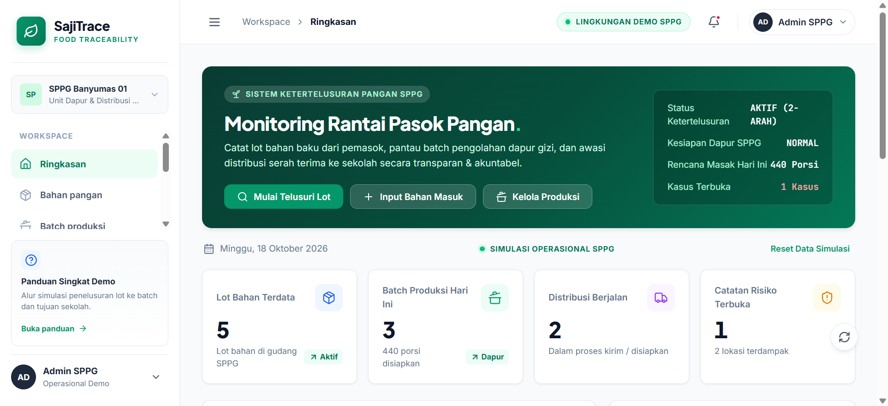
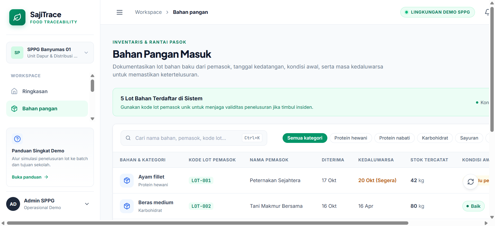
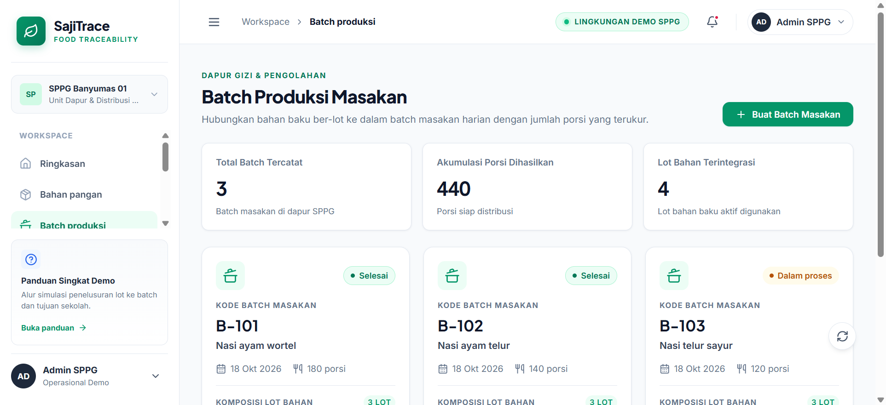
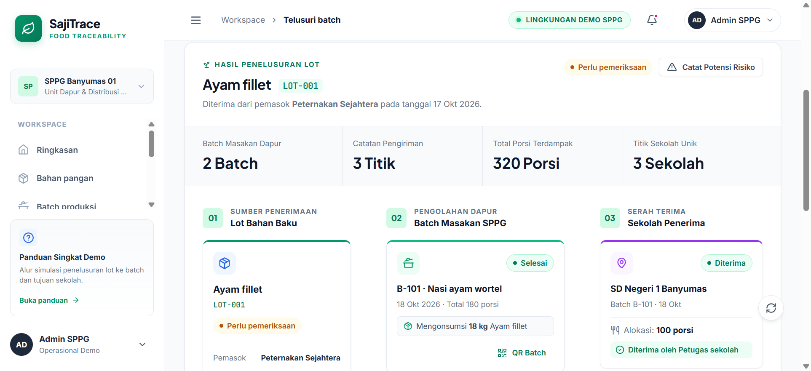
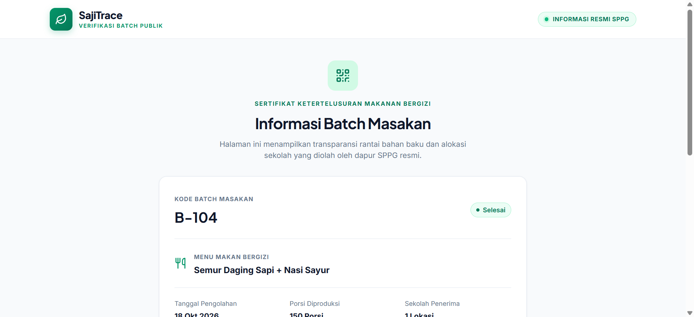

# SajiTrace — Food Traceability Web System (SPPG)

[](https://react.dev/)
[](https://vitejs.dev/)
[](https://nodejs.org/)
[](https://expressjs.com/)
[](LICENSE)

> **SajiTrace** adalah platform web **Ketertelusuran Pangan (*Food Traceability System*)** yang dirancang khusus untuk operasional **SPPG (Satuan Pelayanan Pangan Gizi)** dalam mendukung penyediaan makanan bergizi (seperti Program Makan Bergizi Gratis / MBG untuk sekolah-sekolah).

SajiTrace menghubungkan seluruh siklus rantai pasok pangan: mulai dari **lot penerimaan bahan mentah pemasok**, **proses pengolahan batch di dapur gizi**, **logistik pengiriman & serah terima sekolah**, hingga **penelusuran instan dua arah (*bidirectional tracing*)** saat terjadi potensi insiden keamanan pangan.

---

## 📸 Preview Antarmuka

### 1. Dashboard Eksekutif SPPG
Memantau metrik volume porsi masak hari ini, status pengiriman aktif, lot gudang, dan peringatan dini catatan risiko.


### 2. Inventaris Bahan Pangan & Filter Kategori
Pencatatan lot bahan baku unik dengan tanggal kedaluwarsa, kuantitas stok, dan status fisik awal.


### 3. Batch Masakan Dapur & QR Code Verifikasi
Menghubungkan resep masakan dengan lot bahan baku yang dikonsumsi, dilengkapi generator QR Code verifikasi kemasan.


### 4. Mesin Penelusuran Rantai Pangan 2-Arah (Core Feature)
Memetakan hubungan: **Lot Bahan Baku $\to$ Batch Olahan Dapur $\to$ Sekolah Penerima** dalam hitungan detik.


### 5. Sertifikat Verifikasi Publik (Mobile-Ready)
Tampilan transparan saat QR code pada boks makan siang dipindai oleh kepala sekolah, guru, atau orang tua murid.


---

## ⚡ Fitur Utama

- **Dashboard Real-Time:** Ringkasan KPI harian SPPG, volume porsi batch produksi, dan jejak aktivitas (*audit trail*).
- **Manajemen Bahan Pangan:** Dokumentasi lot pemasok unik, kategori gizi (protein, sayuran, karbohidrat), tanggal terima/kedaluwarsa, dan kondisi fisik.
- **Batch Produksi Dapur:** Pencatatan jadwal masak yang menghubungkan takaran resep dengan kode lot bahan yang digunakan.
- **Distribusi & Serah Terima:** Alokasi porsi ke sekolah tujuan dengan validasi kapasitas batch dan konfirmasi nama petugas penerima di lapangan.
- **Penelusuran 2-Arah (*Bidirectional Traceability*):**
  - **Forward Trace:** Dari kode lot bahan mentah $\to$ batch masakan dapur $\to$ daftar sekolah dan total porsi terdampak.
  - **Backward Trace:** Dari laporan keluhan sekolah $\to$ nomor batch dapur $\to$ identitas lot dan pemasok bahan asalnya.
- **Pusat Risiko & Mutu:** Dokumentasi insiden pangan, mitigasi tindakan korektif, dan kalkulasi otomatis potensi dampak sekolah.
- **QR Code & Public Verification (`/verifikasi/:code`):** Transparansi kemasan ramah perangkat *mobile* tanpa membocorkan data pribadi internal.
- **Mode Simulasi Otomatis (*Guided Demo Tour*):** Tombol sekali klik di bilah atas untuk memperagakan simulasi operasional lengkap secara otomatis dalam tempo cepat (~25 detik).
- **Shortcut Cepat:** Dukungan tombol `Ctrl + K` (atau `Cmd + K`) untuk memfokuskan pencarian instan.
- **Cetak Laporan Resmi:** Tombol cetak langsung (*print-ready*) untuk laporan penelusuran lot dan sertifikat batch.

---

## 🛠️ Teknologi yang Digunakan

- **Frontend:** React 19, Vite 6, Modern CSS (Design Tokens, Responsive Grid, Accessible Modal Patterns).
- **Backend / REST API:** Node.js, Express.js.
- **Penyimpanan Prototipe:** JSON Lokal Persisten (`server/data/sajitrace.json`) dengan *auto-seed initial data*.
- **Ikon & Komponen:** Lucide React, QRCode React (`qrcode.react`).

---

## 📋 Persyaratan Sistem

- **Node.js:** Versi 20.x atau lebih baru (direkomendasikan Node.js 22 LTS).
- **npm:** Versi 9.x atau lebih baru.
- **Sistem Operasi:** Windows, macOS, atau Linux.

---

## 🚀 Panduan Instalasi & Menjalankan

### 1. Clone Repository
```bash
git clone https://github.com/frl-im/sajitrace-web.git
cd sajitrace-web
```

### 2. Pasang Dependensi
```bash
npm install
```

### 3. Jalankan Mode Pengembangan (Development)
```bash
npm run dev
```

Perintah ini akan menjalankan frontend Vite di port `5173` dan Express REST API di port `4000` secara bersamaan melalui `concurrently`.

Buka browser di:
👉 **http://localhost:5173**

---

### Opsi Lain: Menjalankan di Windows (`start.bat`)
Jika Anda menggunakan Windows, Anda dapat langsung mengklik dua kali file `start.bat` di folder proyek. File tersebut akan otomatis memasang dependensi jika belum ada dan langsung menjalankan server.

### Opsi: Menjalankan Versi Produksi Lokal
```bash
npm run build
npm start
```
Buka browser di **http://localhost:4000**.

---

## 🎯 Tata Cara Penggunaan & Alur Demonstrasi

Terdapat dua cara untuk mencoba dan mendemonstrasikan sistem SajiTrace:

### Cara 1: Menggunakan "Mode Simulasi Otomatis" (Sangat Praktis untuk Presentasi)
1. Buka website di browser (**http://localhost:5173**).
2. Klik tombol hijau **"Mulai Simulasi Otomatis"** di sudut kanan atas (sebelah badge lingkungan demo).
3. Sistem akan secara otomatis:
   - Meninjau KPI Dasbor.
   - Menginput bahan baru: *Daging Sapi Segar (LOT-007)*.
   - Mengolahnya ke batch dapur: *B-104 (Semur Daging Sapi, 150 Porsi)*.
   - Mengalokasikan distribusinya ke *SD Negeri 4 Banyumas*.
   - Mengonfirmasi penerimaan oleh *Bpk. Joko Santoso (Kepala Sekolah)*.
   - Melakukan penelusuran 2-arah pada *LOT-007* dan menampilkan diagram rantai pasok secara langsung.
   - Membuka pop-up QR Code verifikasi publik.

---

### Cara 2: Alur Operasional Manual Step-by-Step

#### Langkah 1: Input Bahan Masuk
1. Buka menu **Bahan pangan**.
2. Klik **Tambah bahan masuk**, lalu isi formulir (Nama bahan, kategori gizi, pemasok, kode lot kemasan unik, jumlah, dan kondisi fisik).
3. Klik **Simpan Bahan Masuk**.

#### Langkah 2: Jadwalkan Batch Masakan Dapur
1. Buka menu **Batch produksi**.
2. Klik **Buat Batch Masakan**.
3. Masukkan menu makanan, target porsi, lalu pilih lot bahan baku yang digunakan beserta takarannya dari daftar inventaris.
4. Klik **Simpan Batch Produksi**.
5. Klik tombol **QR Verifikasi** pada kartu batch untuk melihat QR Code yang siap ditempelkan di wadah boks makanan.

#### Langkah 3: Alokasikan Pengiriman Distribusi
1. Buka menu **Distribusi**.
2. Klik **Catat Distribusi Baru**.
3. Pilih batch masakan (sistem otomatis memvalidasi agar porsi tidak melebihi sisa kapasitas batch).
4. Masukkan nama sekolah tujuan, jumlah porsi, dan waktu keberangkatan.
5. Saat makanan tiba di sekolah, klik **Update Status** pada baris pengiriman, ubah status menjadi **Diterima**, dan masukkan nama petugas/guru sekolah yang menerima.

#### Langkah 4: Uji Coba Penelusuran Cepat (Core Traceability)
1. Buka menu **Telusuri batch**.
2. Masukkan kode lot, misalnya: `LOT-001` (atau klik tombol contoh `LOT-001` / `LOT-007`).
3. Klik **Telusuri Sekarang**.
4. Amati diagram alur 3-tahap yang terbentuk secara instan:
   - **Tahap 01 (Sumber):** Identitas lot penerimaan dan pemasok.
   - **Tahap 02 (Proses Dapur):** Batch masakan dapur yang mengonsumsi lot tersebut.
   - **Tahap 03 (Penerima):** Sekolah-sekolah penerima makanan dan total porsi terdampak.
5. Klik **Cetak Laporan Penelusuran** untuk mencetak dokumen fisik atau menyimpan sebagai file PDF.

#### Langkah 5: Dokumentasi Temuan di Pusat Risiko
1. Jika terdapat laporan bahan baku yang mencurigakan, buka menu **Pusat risiko**.
2. Klik **Catat Temuan Risiko**, pilih lot bahan terkait, tingkat keparahan (*Rendah / Sedang / Tinggi*), dan deskripsi temuan.
3. Sistem secara otomatis menghitung berapa batch dan berapa sekolah yang perlu diwaspadai (*food recall isolation*).
4. Klik **Tindak Lanjuti** untuk mendokumentasikan langkah korektif yang telah diselesaikan.

#### Langkah 6: Verifikasi Publik Melalui QR Code
Buka URL verifikasi publik pada browser (mensimulasikan hasil pemindaian kamera ponsel):
`http://localhost:5173/verifikasi/B-101` atau `http://localhost:5173/verifikasi/B-104`.

---

## 📂 Struktur Direktori

```text
sajitrace-web/
├── docs/
│   └── screenshots/            # Tangkapan layar antarmuka untuk dokumentasi
├── server/
│   ├── data/
│   │   └── sajitrace.json      # Database prototipe JSON lokal (auto-seeded)
│   ├── db.js                   # Engine pembaca, penulis, dan seeder data lokal
│   └── index.js                # Server REST API Express.js
├── src/
│   ├── App.jsx                 # Komponen utama React, state manajemen, & router
│   ├── main.jsx                # Entry point aplikasi React
│   └── styles.css              # Styling enterprise modern (tokens, responsive, modal)
├── index.html                  # Dokumen HTML utama
├── package.json                # Metadata proyek dan daftar dependensi
├── start.bat                   # Skrip instan Windows untuk menjalankan dev server
├── start.sh                    # Skrip bash Linux/macOS
├── vite.config.js              # Konfigurasi bundler Vite
└── README.md                   # Dokumentasi lengkap proyek
```

---

## 🔌 Spesifikasi REST API Backend

| Metode | Endpoint | Deskripsi |
|---|---|---|
| `GET` | `/api/summary` | Mendapatkan agregat statistik dasbor dan status operasional |
| `GET` | `/api/materials` | Mengambil daftar seluruh lot bahan pangan di gudang |
| `POST` | `/api/materials` | Menambahkan catatan lot bahan pangan baru dari pemasok |
| `PUT` | `/api/materials/:id` | Memperbarui data lot bahan pangan |
| `GET` | `/api/productions` | Mengambil seluruh batch masakan dapur dan lot bahan tertaut |
| `POST` | `/api/productions` | Membuat batch masakan baru yang mengonsumsi lot bahan |
| `GET` | `/api/distributions` | Mengambil riwayat pengiriman makanan ke sekolah |
| `POST` | `/api/distributions` | Mencatat rute distribusi baru ke sekolah penerima |
| `PUT` | `/api/distributions/:id`| Memperbarui status distribusi (konfirmasi serah terima) |
| `GET` | `/api/trace?q=:term` | Menelusuri rantai 2-arah berdasarkan kode lot atau nama bahan |
| `GET` | `/api/cases` | Mengambil daftar catatan risiko dan kalkulasi dampaknya |
| `POST` | `/api/cases` | Membuat laporan temuan risiko baru |
| `PUT` | `/api/cases/:id` | Memperbarui status dan tindakan mitigasi risiko |
| `GET` | `/api/verify/:code` | Mengambil ringkasan batch untuk verifikasi publik (QR) |
| `GET` | `/api/audit` | Mengambil riwayat log audit aktivitas sistem |
| `POST` | `/api/reset-demo` | Mengembalikan database ke data demonstrasi awal |

---

## ⚠️ Batasan Prototipe MVP

- **Penyimpanan Demonstrasi:** Data disimpan dalam file JSON lokal untuk kemudahan demonstrasi portabel tanpa ketergantungan database server luar.
- **Autentikasi & Otorisasi:** Belum dilengkapi login per-peran (*multi-role access*) karena difokuskan pada validasi alur ketertelusuran (*proof-of-concept*).
- **Integrasi Pihak Ketiga:** Belum terhubung secara langsung ke server pusat SIPGN/BGN, sensor GPS armada pengantar, atau sistem inventaris pihak ketiga.
- **Alat Pendukung:** Sistem ini berfungsi sebagai pencatat riwayat rantai pasok dan pendukung keputusan mitigasi, bukan pengganti uji laboratorium mikrobiologi keamanan pangan resmi.

---

## 📄 Lisensi

Proyek ini dikembangkan sebagai prototipe demonstrasi sistem ketertelusuran pangan untuk lomba/pengujian inovasi teknologi SPPG (S-Tech 2026).
